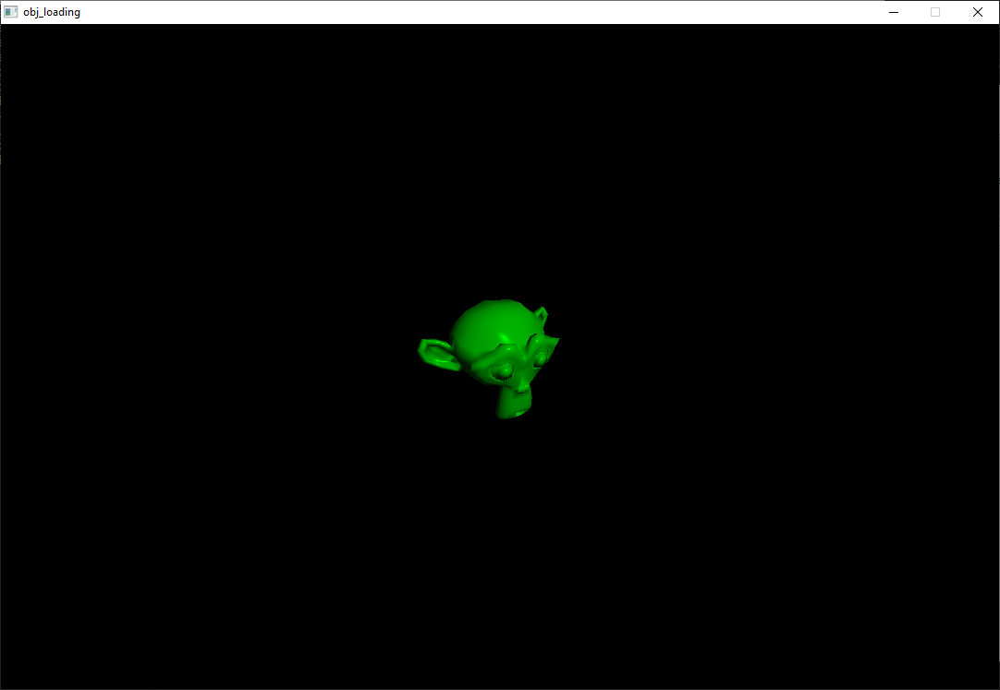
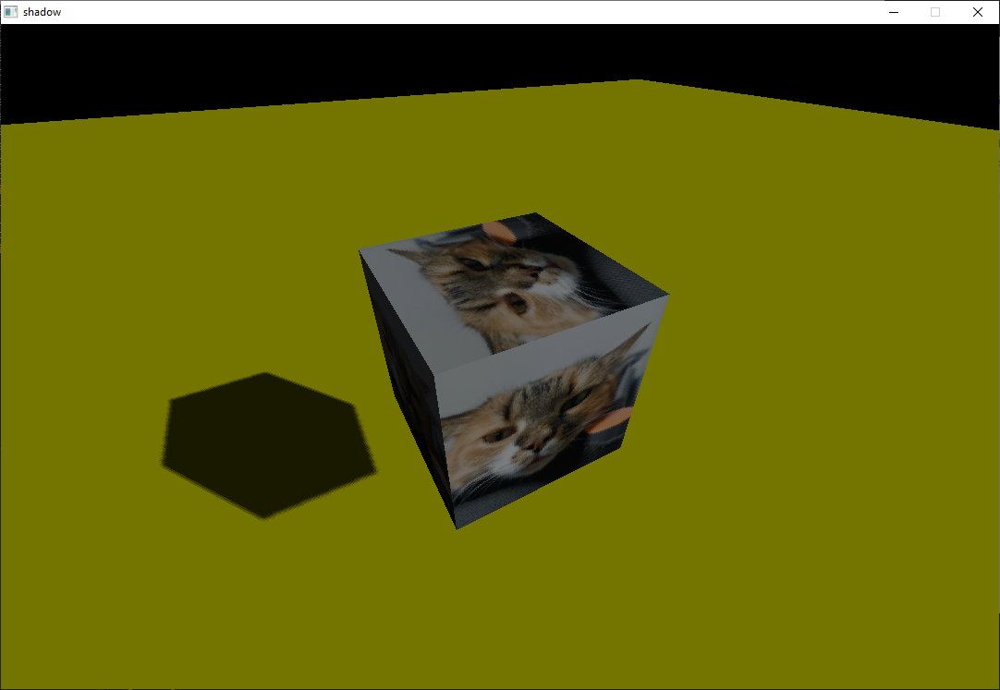

	<h1>DEngine</h1>
	<h3>Cross platform (Android, Windows, Linux) 3D engine.</h3>
	

## About
**DEngine** - Open-Source 3D Engine which supports all (maybe) of needed tools. Engine fully written in C++, for desktops engine uses [GLFW](https://github.com/glfw/glfw), for Android OS OpenGL ES from NDK.

## Features
- Shadows
- Alpha
- Textures
- Normal maps
- Multiple point lights
- Sounds ([miniaudio](https://github.com/mackron/miniaudio))
- Textures (stb_image.h)

## Support/Backend
| OS | OpenGL Version |
| --- | --- |
| Windows | OpenGL Core 3.3 |
| Android | OpenGL ES 3.2 |
| Linux | Open GL Core 3.3 |
| Vulkan | *Planned* |
## Requirements
- **CMake**: Version 3.10 or older.
- **GLFW**: Version 3.4 (for Windows platforms it already in third_party folder).
- **GLEW**: Version 2.3.1 (for Windows platforms in third_party folder too).
- **GPU**: Must support OpenGL 3.3 or OpenGL 3.2 ES.
## Build
### CMake flags
- **DENGINE_COMPILE_SAMPLES**: Compile samples for desktops if ON, **not** supported on Android yet.
- **BUILD_SHARED_LIBS**: Enabled by default.

*CMakePresets.txt based on my PC, so maybe you should delete this.*

## Screenshots

